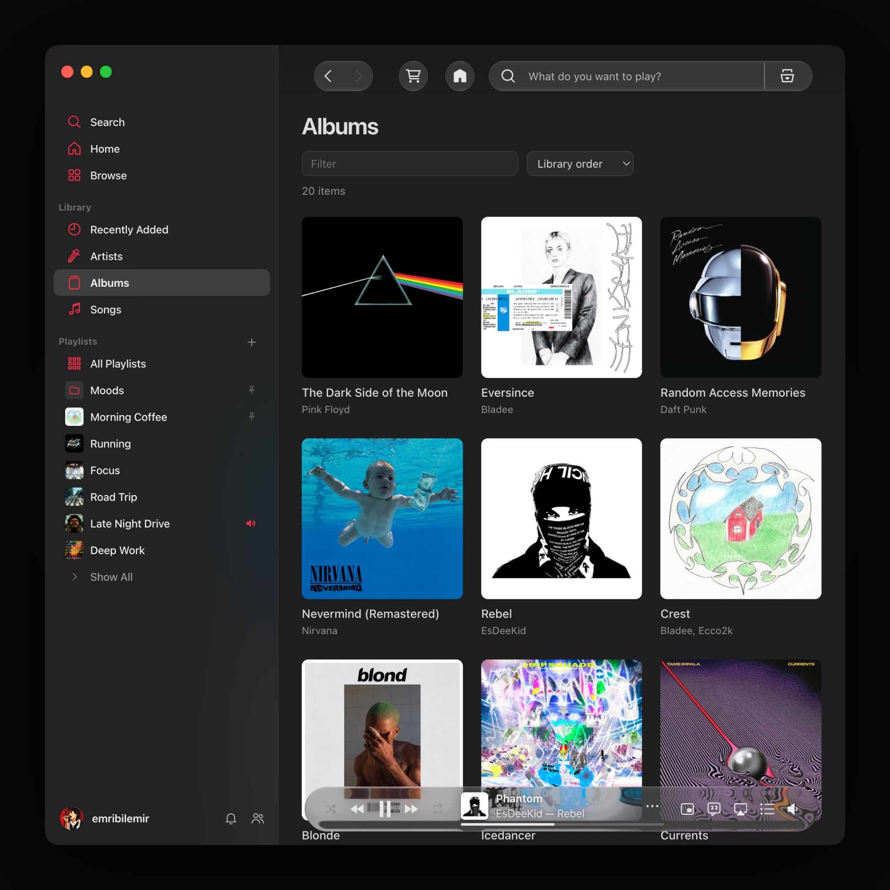

<div align="center">

# mcloud

**Spotify'ı Apple Music gibi gösteren bir [Spicetify](https://spicetify.app) teması.**

Kalıcı yan menü, yüzen oynatıcı, kapaklı kitaplık görünümü ve Spicy Lyrics entegrasyonu.



</div>

## Kurulum

[Spicetify](https://spicetify.app/docs/getting-started) önceden kurulu olmalı. Kurulum komutu Spicetify'ı kurmaz, yalnızca temayı yükler.

**macOS / Linux**

```sh
curl -fsSL https://raw.githubusercontent.com/bulutakbulutt/mcloud/main/install.sh | sh
```

**Windows** (PowerShell, yönetici olarak *açmadan*)

```powershell
iwr -useb https://raw.githubusercontent.com/bulutakbulutt/mcloud/main/install.ps1 | iex
```

Betik şunları yapar:

1. Spicetify'ın kurulu olduğunu kontrol eder. Kurulu değilse ne yapmanız gerektiğini söyleyip durur.
2. `theme.js`, `user.css` ve `color.ini` dosyalarını Spicetify'ın `Themes/AppleMusicMac` klasörüne indirir.
3. Temayı seçer (`inject_css`, `inject_theme_js` açık) ve `spicetify apply` çalıştırır. Gerekirse önce yedek alır.

> [!TIP]
> Söz düğmeleri [Spicy Lyrics](https://github.com/Spikerko/spicy-lyrics) eklentisiyle çalışır. Eklentiyi Spicetify Marketplace'ten kurabilirsiniz.

## Özellikler

- **Apple Music yerleşimi:** Kırmızı simgeli kalıcı sol menü, sol alt köşede profil ve Ana Sayfa ile açılış.
- **Apple Music oynatıcısı:** Pencereyle birlikte en fazla 700 piksele kadar genişler, sonra içeriğin ortasında kalır. Cam görünümü alttaki sayfanın rengini alır. Ortada albüm kapağı, şarkı adı ve kayan "Sanatçı — Albüm" satırı yer alır.
  - Alttaki ince ilerleme çizgisi her zaman tıklanabilir. Üzerine gelince kalınlaşır, geçen ve kalan süre görünür, rakamlar Apple Music gibi kayarak değişir.
  - Kapağın üzerine gelince tam ekran düğmesi çıkar.
  - ☆ ile şarkıyı Beğenilen Şarkılar'a ekleyebilirsiniz. "…" menüsünde albüme veya sanatçıya gitme ve bağlantı kopyalama seçenekleri var.
- **Sanatçı sayfaları:** Apple Music tarzında yeniden çizilir.
  - Tam genişlikte sanatçı görseli, büyük isim, oynat ve takip et düğmeleri var.
  - Son Çıkan ve Popüler Şarkılar yan yana; ardından Albümler, Single'lar ve EP'ler, Yaklaşan Konserler, Yer Aldığı ve Benzer Sanatçılar rafları geliyor.
  - Tüm pencere sanatçının rengine bürünür.
  - Spotify'ın görünümüne geçmek için sağ üstteki "…" menüsünden **Spotify Sayfasında Aç**'ı seçin.
- **Kitaplık:** Hesabınızdaki listeler, albümler ve sanatçılar kapaklarıyla listelenir. İsme göre filtrelenebilir, kitaplık sırasına ya da A–Z'ye göre sıralanabilir.
- **Spicy Lyrics:** Oynatıcıdan sözleri açıp kapatabilir, tam ekrana geçebilirsiniz.
- **Vurgu rengi:** Kırmızı, pembe, turuncu, sarı, yeşil, turkuaz, mavi, mor veya Spotify yeşili.
- **Yazı tipi:** macOS'ta Apple'ın kendi fontu SF Pro kullanılır. Windows ve Linux'ta temaya gömülü Inter kullanılır; internetten bir şey indirilmez ve tüm Türkçe harfleri içerir.
- **Hafif:** Yalnızca ekrandaki kapaklar yüklenir. Görünmeyen kapakların kaynakları bırakılır, pencere gizliyken arka plan işleri durur.

## Ayarlar

Sol alt köşedeki **profilinize** tıklayınca vurgu rengini seçebilir, Spotify profilinizi ve ayarlarınızı açabilirsiniz. Spotify'ın sağ üstteki **profil menüsü → mcloud** altında da şu ayarlar var:

| Ayar | Açıklama |
| --- | --- |
| Oynatıcıda albüm kapağı | Oynatıcıda çalan parçanın kapağını gösterir. |
| Liquid Glass oynatıcı | macOS 26 tarzı cam efekti: oynatıcının kenarlarında arkadaki sayfa kırılır. Kapatınca klasik buzlu cama döner. |
| Renk: … | Vurgu rengini değiştirir. |

Ayarlar bu bilgisayarda saklanır ve Spotify yeniden başlasa da korunur.

## Kısayollar

| Kısayol | İşlev |
| --- | --- |
| İlerleme çizgisine tıklama / sürükleme | Şarkıda o noktaya gider. |
| Kenar çubuğunun sağ kenarını sürükleme | Kenar çubuğunu genişletir veya daraltır. Çift tıklama varsayılana döndürür. |
| Ses simgesi üzerinde fare tekerleği | Sesi %5 adımlarla değiştirir. |
| <kbd>⌘</kbd>/<kbd>Ctrl</kbd> + <kbd>F</kbd> (kitaplıkta) | Filtre kutusuna odaklanır. |
| <kbd>Esc</kbd> (filtre kutusunda) | Filtreyi temizler. |

## Güncelleme ve kaldırma

Güncellemek için kurulum komutunu tekrar çalıştırın. Spotify güncellendikten sonra tema kaybolursa yine aynı komutu çalıştırmanız yeterli.

Kaldırmak için:

```sh
# macOS / Linux
curl -fsSL https://raw.githubusercontent.com/bulutakbulutt/mcloud/main/install.sh | sh -s -- --uninstall
```

```powershell
# Windows
& ([scriptblock]::Create((iwr -useb https://raw.githubusercontent.com/bulutakbulutt/mcloud/main/install.ps1))) -Uninstall
```

Belirli bir sürümü kurmak için `--ref <etiket>` (Windows'ta `-Ref <etiket>`) kullanın.

<details>
<summary><b>Elle kurulum</b></summary>

`theme.js`, `user.css` ve `color.ini` dosyalarını Spicetify'ın tema klasörüne kopyalayın:

| Sistem | Klasör |
| --- | --- |
| macOS / Linux | `~/.config/spicetify/Themes/AppleMusicMac/` |
| Windows | `%APPDATA%\spicetify\Themes\AppleMusicMac\` |

Ardından şunları çalıştırın:

```sh
spicetify config current_theme AppleMusicMac color_scheme Dark inject_css 1 inject_theme_js 1
spicetify apply
```

</details>

## Sorun giderme

<details>
<summary><b>Spotify güncellendi, tema gitti</b></summary>

Kurulum komutunu tekrar çalıştırın. Betik gerekirse `spicetify backup apply` veya `spicetify restore backup apply` da dener.
</details>

<details>
<summary><b>Linux'ta "permission denied" hatası</b></summary>

Spicetify'ın Spotify klasörüne yazma izni olmalı. Betik bu durumu algılarsa gereken komutları yazar. Genelde şöyledir:

```sh
sudo chmod a+wr /usr/share/spotify
sudo chmod a+wr -R /usr/share/spotify/Apps
```

Snap ile kurulmuş Spotify Spicetify ile çalışmaz. Flatpak, AUR veya spotify.com paketini kullanın.
</details>

<details>
<summary><b>Windows'ta Spicetify çalışmıyor</b></summary>

Microsoft Store'daki Spotify desteklenmez; [spotify.com](https://www.spotify.com/download/windows/) sürümünü kurun. PowerShell'i yönetici olarak açmayın.
</details>

<details>
<summary><b>"Spicy Lyrics henüz hazır değil" uyarısı</b></summary>

Spicy Lyrics kurulu değil ya da henüz yüklenmedi. Eklentiyi Marketplace'ten kurun ve Spotify'ın tamamen açılmasını bekleyin.
</details>

## Uyumluluk

Spotify 1.3.6.1921 ve Spicetify 2.46.2 ile macOS'ta hazırlandı. Kurulum betikleri macOS, Linux ve Windows'ta çalışır, ancak tema en çok macOS'ta denendi. Spotify arayüz güncellemeleri uyarlama gerektirebilir; bir sorun görürseniz Spotify ve Spicetify sürümlerinizle birlikte [issue açın](https://github.com/bulutakbulutt/mcloud/issues).


Apple veya Spotify ile bağlantılı resmî bir proje değildir. Tema Spotify içeriğini kullanır.
